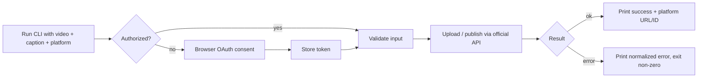

# 01 — Requirements: Phase 0 (CLI Proof of Concept)

**Goal:** validate the end-to-end publishing workflow against a real platform and learn the real constraints. Not a product.

## User journey

## Functional requirements
| ID | Requirement |
|---|---|
| P0-F1 | Accept a path to an MP4 file and a caption (inline option or text file). |
| P0-F2 | Accept a platform choice from the supported list. YouTube is first; others are added only after feasibility is validated. |
| P0-F3 | Authenticate via the platform's official OAuth flow (loopback redirect with PKCE where supported). |
| P0-F4 | Persist the token locally so later runs don't re-authorize; refresh when expired. |
| P0-F5 | Validate input before upload: file exists, is readable, extension/container is MP4, size within platform limit, caption within platform limit. |
| P0-F5a | Read video dimensions and duration from the MP4 header. For YouTube, warn (not fail) when the video is not vertical or exceeds the Shorts length, since it would publish as a normal video. Facebook/Instagram adapters must fail validation for non-9:16 or out-of-range duration. |
| P0-F6 | Publish the video with the caption through the official API. |
| P0-F7 | Report success (with platform post/video ID and URL) or failure (with normalized, human-readable reason). Exit code 0 on success, non-zero on failure. |
| P0-F8 | Record each attempt (id, platform, status, timestamps, platform ID, error) in a local SQLite DB. |
| P0-F9 | Provide a command to list recent attempts. |
| P0-F10 | Provide a command to remove stored credentials for a platform. |

## Non-functional requirements
- Runs on Windows, macOS, Linux with Python 3.12+.
- Tokens never printed or logged; stored with restrictive permissions or OS keyring.
- Large file upload uses the platform's resumable mechanism where offered; progress shown.
- Core publishing logic lives in an importable module with **no CLI dependency** (so Phase 1 reuses it).
- Network-free unit tests for core logic; real-API tests are opt-in.

## Explicitly not in Phase 0
Web UI, user accounts, multi-user, multiple simultaneous destinations in one command, scheduling, AI, n8n, analytics, cloud storage, Postgres.

## Acceptance criteria
1. With a valid MP4, caption and YouTube authorization, `publish` results in a video visible on the authorizing channel and prints its URL.
2. A second run reuses the stored authorization without a browser prompt.
3. An invalid file (missing, non-MP4, oversized) fails *before* any network upload with a clear message and non-zero exit.
4. Revoked/expired authorization yields a clear "re-authorize" message, not a stack trace.
5. A mid-upload network failure reports failure and is recorded as failed; no false success.
6. Attempt history lists all of the above with correct statuses.
7. Findings on quota, audit/review requirements, and privacy-status restrictions are written into `09-open-questions.md` / an ADR.

## Platform feasibility checklist (to complete during Phase 0)
For each platform: API/endpoint used, required scopes/permissions, app-review or audit needs, account-type requirements, file/caption limits, quota, test-user mechanism, whether published content is public or restricted for unreviewed apps. See `09-open-questions.md`.
