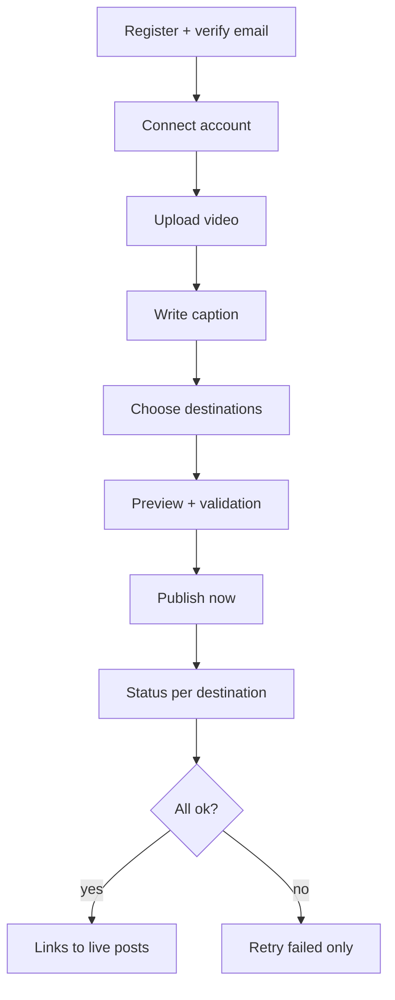

# 03 — Product Design

Design intent: calm, obvious, honest. Few screens, clear status, no dark patterns.

## Personas
**Maya, solo creator** — films short and long videos, posts to YouTube and Instagram, wants to stop re-typing captions and wants to *know* it posted.

## Journeys

### J1 — First publish (Phase 1)

### J2 — Recover from failure
Open history → see destination "Failed: token expired" → click *Reconnect* → return → *Retry* → success. Successful destinations are untouched.

### J3 — Disconnect / leave
Settings → disconnect an account (confirmation explains platform-side revocation) or delete account (explicit, irreversible, lists what is deleted).

### J0 — Phase 0 (CLI)
`publish` → browser consent (first time only) → progress → success URL or clear error.

## Screens (Phase 1)
1. **Sign in / Register / Reset**
2. **Accounts** — connected accounts, status badges, connect/disconnect.
3. **Library** — uploaded videos, upload progress, delete.
4. **Compose** — video picker, caption editor, destination checkboxes with per-destination validation messages and optional per-destination caption override.
5. **Preview** — video player + per-destination caption rendering and limits.
6. **History** — list of posts; detail view with per-destination timeline.
7. **Settings** — profile, delete account.

## Status vocabulary (used identically in CLI, API, UI)
`draft` → `queued` → `uploading` → `processing` → `published` | `failed` | `needs_reauth`  
(`processing` = platform is transcoding/verifying; see `04-architecture-overview.md` for the lifecycle.)

## UX rules
- Publishing always requires an explicit button press showing destinations and caption.
- Error messages say what happened, whether retrying helps, and what to do next.
- Never show raw tokens or stack traces.
- Platform limits are shown *before* publish, not discovered after.
- (Future) Any AI-modified caption/media is visibly marked and requires creator approval before it can be published.

## Deliberately absent
Calendars, scheduling pickers, AI buttons, analytics charts, team features. Do not add placeholder UI for them.
