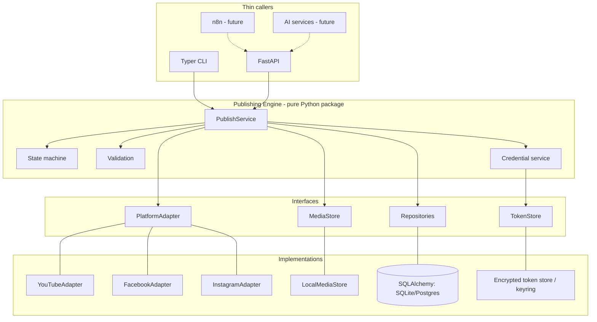
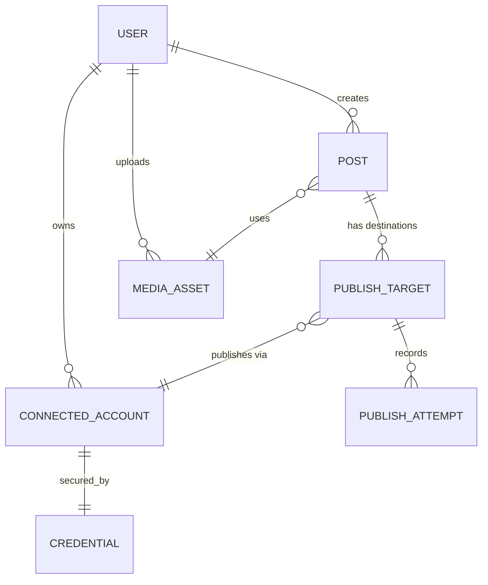
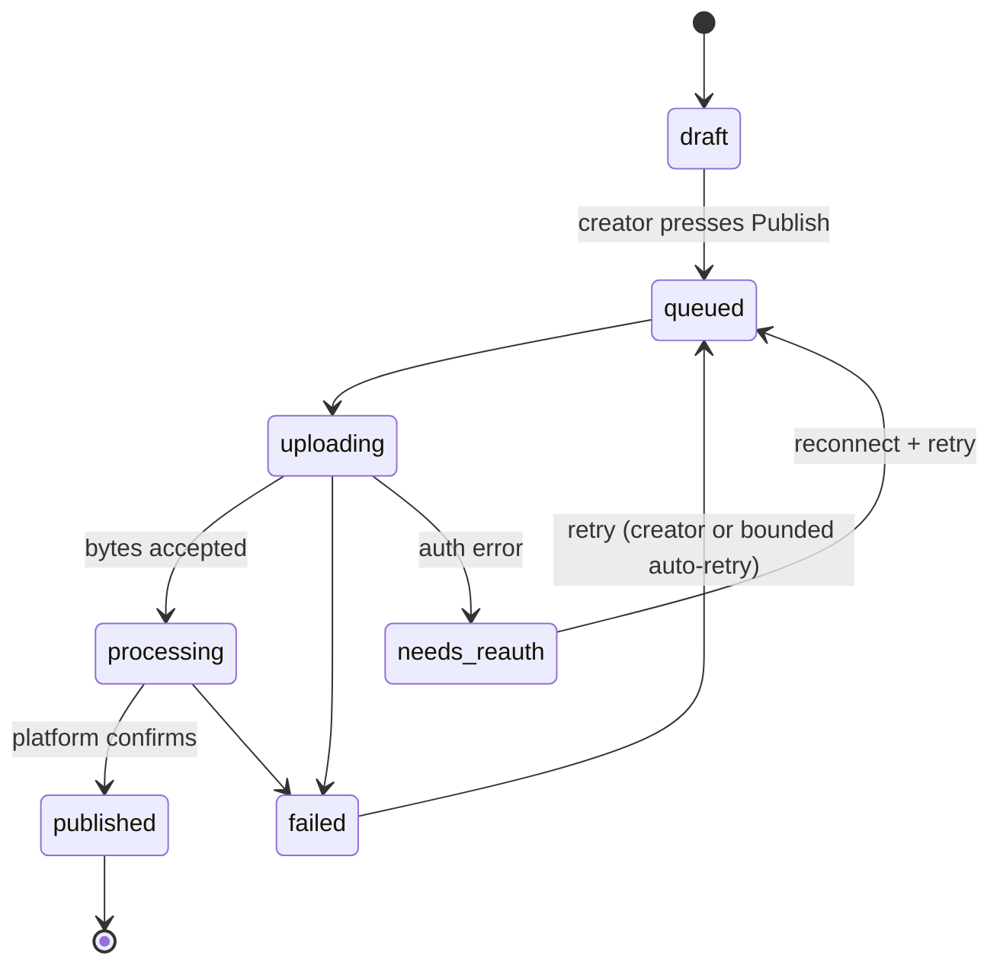

# 04 — Architecture Overview

Status: **proposed**. Technology choices are proposals; changing them needs an ADR (`adr/`).

## Principles
1. Modular monolith; one deployable backend.
2. Publishing engine is independent of CLI, web, n8n, and AI providers.
3. Adapters isolate platform differences.
4. Storage behind an interface.
5. Explicit, persisted publishing state machine.
6. No infrastructure without a demonstrated need (no microservices, Kubernetes, Redis, brokers).

## Proposed stack
| Concern | Choice | Phase |
|---|---|---|
| Language | Python 3.12+ | 0, 1 |
| CLI | Typer | 0 |
| API | FastAPI | 1 |
| Frontend | Next.js + TypeScript | 1 |
| DB | SQLite → PostgreSQL | 0 → 1 |
| ORM/migrations | SQLAlchemy + Alembic | 0, 1 |
| Media storage | Local filesystem behind `MediaStore` | 0, 1 |
| Jobs | In-process worker + DB job table (initially) | 1 |

## Layered view

Dependency rule: arrows point inward only. The core imports nothing from shells or implementations.

## Domain entities

| Entity | Notes |
|---|---|
| User | Phase 1 only. Phase 0 has an implicit local user. |
| ConnectedAccount | platform, external account/channel/page id, display name, status, granted scopes. |
| Credential | Encrypted access/refresh token, expiry. Separate from ConnectedAccount. |
| MediaAsset | storage key, size, checksum, duration/codec metadata, owner. |
| Post | media + base caption + owner; `ai_modified` / `approved_by_creator` flags reserved for future (not used in Phase 1). |
| PublishTarget | Post × ConnectedAccount; caption override; current status; platform post id/url. |
| PublishAttempt | One try: start/end, outcome, normalized error, raw platform response (sanitized). |

## Publishing lifecycle

Rules: every transition is persisted with timestamp; only `failed`/`needs_reauth` are retryable; before a retry the engine checks for evidence of prior success (stored platform id, or platform lookup where possible) to avoid duplicates; on startup, targets stuck in `uploading`/`processing` beyond a timeout are reconciled.

## Platform adapter contract
```python
class PlatformAdapter(Protocol):
    platform: Platform
    def authorization_url(self, state: str, code_challenge: str) -> str: ...
    def exchange_code(self, code: str, verifier: str) -> Credential: ...
    def refresh(self, cred: Credential) -> Credential: ...
    def revoke(self, cred: Credential) -> None: ...
    def validate(self, media: MediaInfo, caption: str, account: ConnectedAccount) -> list[Issue]: ...
    def publish(self, media: MediaHandle, caption: str, cred: Credential,
                progress: ProgressSink) -> PublishResult: ...
    def check_status(self, ref: PlatformRef, cred: Credential) -> PublishStatus: ...
```
Adapters map platform errors to a shared taxonomy: `Retryable`, `AuthExpired`, `PolicyRejected`, `QuotaExceeded`, `Permanent`. Implemented signatures (Phase 0) differ slightly: `authorization_url`/`exchange_code` take a `redirect_uri`; `publish` takes `MediaInfo` + `PublishRequest`; `check_status` is deferred until Phase 1 needs reconciliation. Platform notes (all **to be validated**) in `09-open-questions.md`.

## Authentication
- Platform auth: OAuth 2.0 authorization-code (+PKCE where supported). Phase 0: loopback redirect on localhost. Phase 1: web redirect handled by FastAPI with signed `state`.
- App auth (Phase 1): email + password, server-side sessions or short-lived JWT in HttpOnly cookie — decision recorded in an ADR.

## Storage
`MediaStore` interface: `put(stream) -> key`, `open(key) -> stream`, `delete(key)`, `stat(key)`. Local filesystem implementation first (configurable directory, keys not derived from user filenames). A cloud implementation (GCS/S3) can be added later without touching the core; it is optional and not a prerequisite.

## Deployment
- Phase 0: `pipx`/venv install on the creator's machine.
- Phase 1: one backend process + one Next.js process + PostgreSQL + a media directory. A single VM or a PaaS is sufficient. Containerization optional.

## Future extension points (NOT committed; no code in current phases)
| Future feature | Where it plugs in |
|---|---|
| Scheduling | A `scheduled_for` on Post + a scheduler calling `PublishService`. |
| n8n | Authenticated API client of FastAPI; engine untouched. |
| AI optimization | Produces *proposed* caption/media variants; creator approval gate before `draft → queued`. |
| Agentic research | Separate module reading its own data; no coupling to publishing. |
| Analytics | Adapter method for metrics + new tables. |
| New platforms | New `PlatformAdapter`. |

## Risks
See `08-roadmap-and-acceptance.md`.
