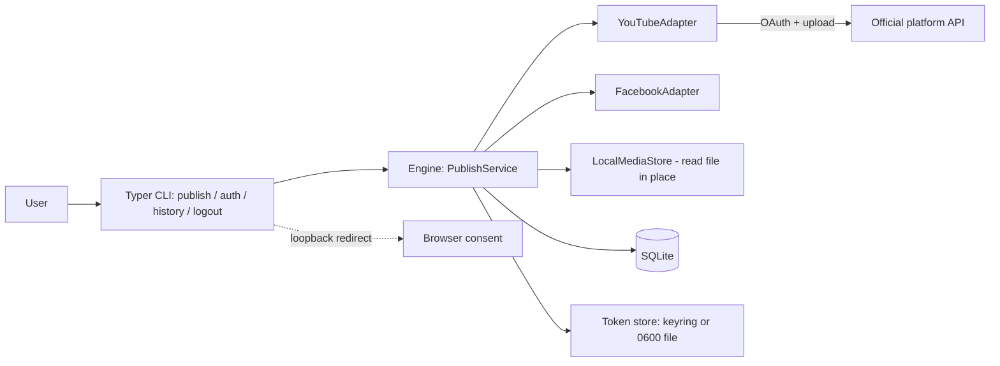
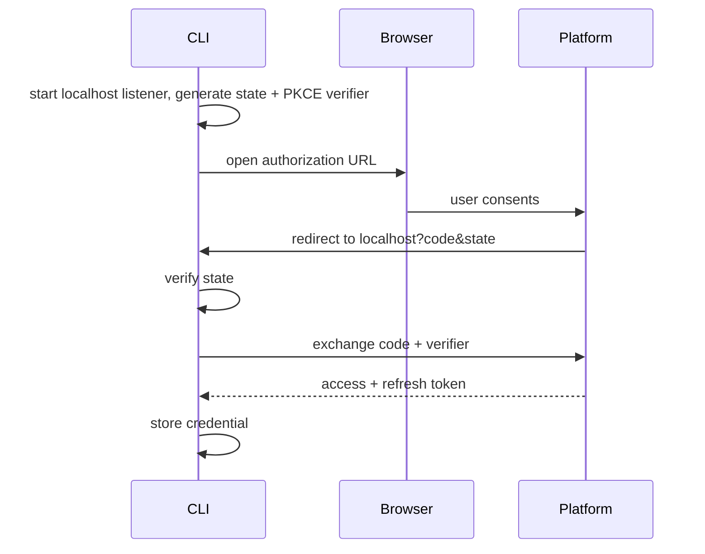

# 05 — Architecture: Phase 0 (CLI)

Scope per `01-requirements-phase-0.md`. Nothing here covers web, users, or future features.

## Components


## Repo layout (implemented)
```
src/studio/
  core/        # engine: models, state machine, services, ports (no CLI/web imports)
  adapters/    # youtube.py (first); facebook/instagram only after validation
  auth/        # OAuth loopback+PKCE flow, keyring token store
  persistence/ # SQLAlchemy models, repos, Alembic
  cli/         # Typer app (thin)
tests/
```

## Commands
| Command | Behavior |
|---|---|
| `studio auth <platform>` | Run OAuth, store credential. |
| `studio publish <video.mp4> --platform youtube\|facebook --caption "…"` | Validate → ensure auth → upload → report. |
| `studio history [--limit N]` | List attempts from SQLite. |
| `studio logout <platform>` | Revoke (best effort) and delete stored credential. |

## Data (SQLite)
Tables: `connected_account`, `post`, `publish_target`, `publish_attempt` — the same shapes as Phase 1 minus `user`, so migration to PostgreSQL + users is additive. Alembic from day one.

## Auth flow (loopback + PKCE)

Client credentials come from env/config. Open point: shipping a client secret in a distributed CLI (see `09`).

## Publish flow
1. Validate local file and caption (adapter limits).
2. Load credential; refresh if expired; on failure → `needs_reauth` message.
3. Create `post` + `publish_target` + attempt (`queued`→`uploading`).
4. Adapter performs resumable upload with progress.
5. On accepted → `processing` → `published` (store platform id, URL) or `failed` (normalized error).
6. Print result; exit code 0/non-zero.

## Out of Phase 0
Concurrency, multi-destination in one command, background jobs, encryption-at-rest beyond OS keyring/file permissions, any web component.

## Test strategy
Unit tests with a fake adapter for the state machine and validation; adapter tests against recorded/mocked HTTP; one manual, opt-in real-account test script documented (not in CI).
