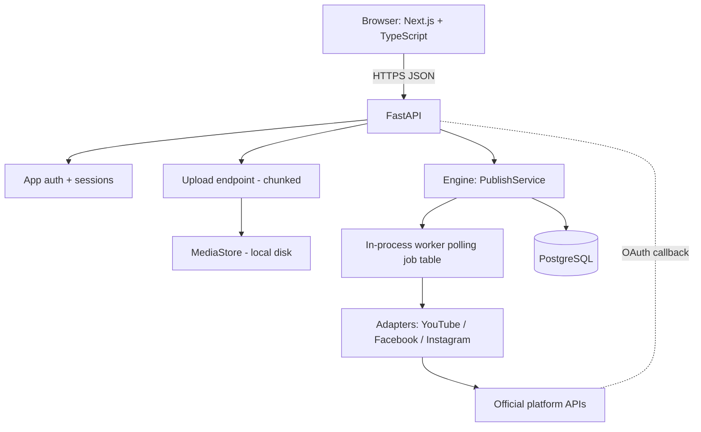
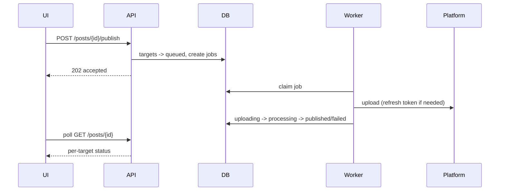

# 06 — Architecture: Phase 1 (Web Application)

Builds on `04` and `05`. Reuses the Phase 0 engine unchanged where possible. Excludes all future features.

## Components


## Key decisions (proposed; ADRs to be written)
| Topic | Proposal | Rationale |
|---|---|---|
| Background work | Worker thread/process in the same app reading a `publish_job` table (`SELECT … FOR UPDATE SKIP LOCKED`) | No Redis/broker; durable; recoverable. |
| Upload | Chunked/resumable uploads to FastAPI → `MediaStore` | Large video, flaky networks. |
| Sessions | HttpOnly, SameSite cookies with server-side session rows | Simple revocation; no JWT complexity. |
| Token encryption | App-level envelope: AES-GCM with key from env/secret manager | Works anywhere; no cloud lock-in. |
| API shape | REST + OpenAPI; generated TS client | Frontend type-safety. |
| Status updates | Polling every few seconds | SSE/WebSocket only if polling proves insufficient. |
| Deployment | Single VM/PaaS: API, worker, Next.js, Postgres, media volume | Minimal ops. |

## API surface (illustrative)
```
POST /auth/register | /auth/login | /auth/logout | /auth/reset
GET  /accounts           POST /accounts/{platform}/connect   GET /oauth/{platform}/callback   DELETE /accounts/{id}
POST /media (chunked)    GET /media    DELETE /media/{id}
POST /posts              GET /posts    GET /posts/{id}
POST /posts/{id}/publish POST /targets/{id}/retry
DELETE /me
```

## Publish sequence

Restart recovery: on boot, jobs with stale heartbeat are reconciled via `check_status` or marked `failed`.

## Multi-tenancy
Every row is owned by a `user_id`; every repository query is scoped by it. Tests must include cross-user access attempts.

## Migration from Phase 0
SQLite schema → Alembic migration adds `user`, `credential` encryption, `media_asset`, `publish_job`; Phase 0 data is not migrated (CLI is a PoC) unless trivial.

## Media constraint (Instagram/Facebook)
Some Meta publishing flows require a publicly reachable video URL, which conflicts with private local storage. See `09-open-questions.md` Q5; options include resumable upload endpoints, or short-lived signed URLs. Decide after validation.

## Observability
Structured logs with request/job IDs; health endpoint; no external APM until needed.

## Testing
Unit (core), integration (API + Postgres test container or local DB), adapter contract tests with mocked HTTP, minimal Playwright smoke for the critical journey.
