# 08 — Roadmap, Acceptance, and Risks

## Roadmap (committed scope only)

```mermaid
gantt
  dateFormat  X
  axisFormat  %s
  title Relative sequence (no dates committed)
  section Phase 0
  Platform feasibility research     :a1, 0, 2
  Core engine + persistence         :a2, 2, 4
  YouTube adapter + CLI             :a3, 4, 7
  Hardening + findings              :a4, 7, 8
  section Phase 1
  Web foundations (auth, DB, API)   :b1, 8, 11
  Accounts + uploads                :b2, 11, 14
  Compose, preview, publish, history:b3, 14, 18
  Retry, hardening, deploy          :b4, 18, 21
  Facebook then Instagram (if validated):b5, 21, 25
```

Units are relative effort, not dates.

## Phase 0 milestones
| # | Milestone | Done when |
|---|---|---|
| M0.1 | Feasibility notes for YouTube (and brief notes for FB/IG) | Written in `09`/ADR; real constraints known |
| M0.2 | Core skeleton + SQLite + state machine with fake adapter | Unit tests pass without network |
| M0.3 | YouTube OAuth via CLI | Token stored, refresh works |
| M0.4 | YouTube publish | Real video published; acceptance 1–6 of `01` |
| M0.5 | Phase 0 retrospective | Findings and Phase 1 go/no-go per platform recorded |

## Phase 1 milestones
| # | Milestone | Done when |
|---|---|---|
| M1.1 | Backend foundation: FastAPI, Postgres, Alembic, registration/login | `02` AC1 |
| M1.2 | Connect/manage accounts | AC2, AC5 |
| M1.3 | Upload + library | chunked/resumable upload works |
| M1.4 | Compose, preview, publish now, history | AC3, AC6 |
| M1.5 | Failure handling and retries | AC4 |
| M1.6 | Security hardening, privacy policy, account deletion | AC7, AC8 |
| M1.7 | Facebook adapter | only after review feasibility confirmed |
| M1.8 | Instagram adapter | only after feasibility confirmed |

## Cross-phase acceptance
- Docs agree with code and each other at every milestone.
- No out-of-scope feature appears in code, API, or UI.
- Core engine has zero imports from CLI/web/adapters.

## Risks
| Risk | Likelihood | Impact | Mitigation |
|---|---|---|---|
| Platform app review / audit delays or rejection | High | High | Start applications early; ship YouTube-first; treat FB/IG as gated. |
| Unverified apps restricted (e.g. content forced private) | High | High | Verify in Phase 0; plan audit path. |
| API quota limits (YouTube upload cost) | Med | Med | Measure; show quota errors clearly; request increase if needed. |
| Instagram account-type requirements (professional account linked to a Facebook Page) | High | Med | Document eligibility checks in the connect flow. |
| Instagram/Facebook needing public media URLs | Med | Med | Evaluate resumable upload vs. signed URLs; ADR. |
| Token expiry/revocation | High | Med | Refresh logic, `needs_reauth` state, clear UX. |
| Large uploads fail midway | High | Med | Resumable uploads, retry with checkpointing. |
| Duplicate posts on retry | Med | High | Idempotency checks, store platform IDs, reconcile before retry. |
| Platform API changes/deprecations | Med | Med | Adapter isolation, contract tests, version pinning. |
| Scope creep toward AI/scheduling | High | Med | CLAUDE.md rules; explicit out-of-scope lists. |
| Solo-dev bandwidth | High | Med | Small scope, boring tech. |
| Secret/token leakage | Low | High | See `07`. |
